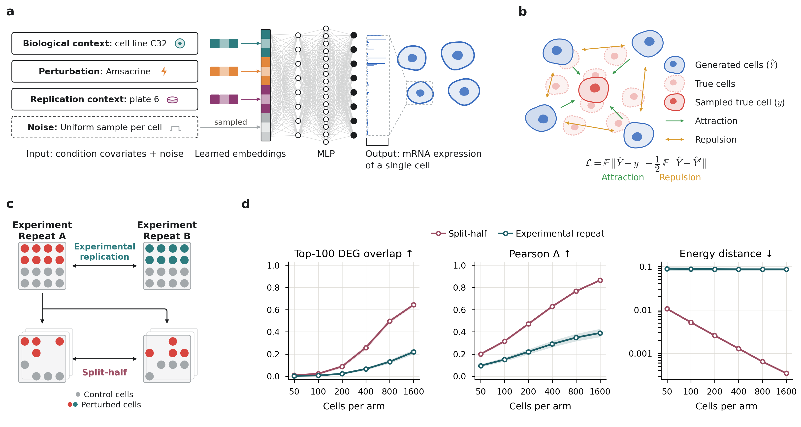

# GENESIS

**Single-cell perturbation prediction near experimental reproducibility**

[](https://www.python.org/downloads/)
[](https://github.com/astral-sh/uv)
[](LICENSE)



GENESIS (Generative ENErgy-based Single-cell Intervention Simulator) predicts the distribution of single-cell
responses directly from the covariates that define an experimental condition, with a lightweight neural network
trained with the energy score. Its error is read against the reproducibility of repeated measurements of the same
condition. This repository holds the model, its training and scoring code, and the code behind every figure.

## Highlights

- **Whole cell populations, not averages.** GENESIS generates single cells for a condition from its covariates alone.
- **Trained with the energy score**, a loss that compares generated and measured cells as distributions.
- **Read against the experiment's own noise**: on Tahoe-100M and a PBMC cytokine atlas, every score sits beside the split-half reference and the experimental repeat.
- **Every figure redraws from this repository**, pixel for pixel; its checkpoints and scores are in the data release.

## Installation

Install [uv](https://docs.astral.sh/uv) (every package is pinned in `uv.lock`); run every command from the repository root.

```bash
git clone https://github.com/rickconci/GENESIS.git && cd GENESIS
uv sync                  # redraw the figures: Python 3.12, CPU only
uv sync --extra model    # predict, train and score: adds CUDA 12.8 PyTorch (Linux and Windows only)
```

## Getting started

### Download

The data release is on Hugging Face: the GENESIS checkpoints ([RConci/GENESIS](https://huggingface.co/RConci/GENESIS))
and every published score ([RConci/GENESIS_results](https://huggingface.co/datasets/RConci/GENESIS_results)). Fetch
them into the repository root:

```bash
uvx --from huggingface_hub hf download RConci/GENESIS --include 'runs/*' --local-dir .
uvx --from huggingface_hub hf download RConci/GENESIS_results --repo-type dataset --include 'core_results/*' --local-dir .
```

To predict, one run is enough: `--include 'runs/tahoe/bio/main/*/260916_114938_*'` fetches Figure 2's Tahoe GENESIS.

- **The datasets**, for training and scoring: [Tahoe-100M](https://huggingface.co/datasets/tahoebio/Tahoe-100M)
  (also via the [Arc Virtual Cell Atlas](https://docs.lamin.ai/arc-virtual-cell-atlas)) and Parse Biosciences' [10 million human PBMCs](https://www.parsebiosciences.com/datasets/10-million-human-pbmcs-in-a-single-experiment/).
  Name their folders in `configs/roots.yaml`; [scripts/data](scripts/data/README.md) builds the caches beside them.

### Redraw the figures

```bash
uv run python -m scripts.figures.draw_all
```

draws the 4 main and 12 Extended Data figures from `core_deliverables/data/` and checks each pixel (`20 of 20 PNGs pixel-identical`).

### Predict with a checkpoint

```bash
RUN=$(ls -d runs/tahoe/bio/main/h4096x8192_nrs256_vg05rs256_5ep_state2k_tahoe_bio_100cond_seed0/260916_114938_*)
uv run python scripts/eval/generate.py conditions --run-dir "$RUN" --out-dir results/generated/tahoe_bio
```

generates Figure 2's Tahoe GENESIS cells for its 4,211 held-out test conditions at their measured cell counts: one
`.npz` per condition, named by its values, with `predictions` (cells x 2,000 genes, float32, log1p), `gene_names`,
`normalization`, `cell_name`, `drug`, `dose` and `plate`. It needs a CUDA GPU and the run folder only; all 4,211 files
take ~66 GB (8.3 million cells), and `--limit N` writes the first N.

### Train

```bash
uv run python -m src.main --config configs/tahoe/bio/main/mlp_h4096x8192_nrs256_vg05_5ep_state2k.yaml devices=1
```

trains Figure 2's Tahoe GENESIS into a new folder under `runs/tahoe/bio/main/` (`use_wandb=false`: no Weights & Biases
account needed). A stopped run resumes from its own folder with `--config <run>/config_resolved.yaml --workdir <run>
resume_ckpt=<run>/checkpoints/last.ckpt`. [configs](configs/README.md) names the config of every published run.

### Score

```bash
OUT=results/figure2 GPU=0 uv run bash scripts/figures/figure2/score/main/score.sh
```

rescores Figure 2's GENESIS, baselines and references into `results/figure2/core_results/`, never into `core_results/`;
`DRY_RUN=1` checks every input without a GPU, and [scripts/figures](scripts/figures/README.md) explains each option.

## Reproduce the paper

Every published number rebuilds at four levels, each from the outputs of the one below ([scripts/figures](scripts/figures/README.md)):

| Level | Rebuilds | From | Every figure |
|---|---|---|---|
| 1 | the figures | the tables in `core_deliverables/data/` (in git) | `uv run python -m scripts.figures.draw_all` |
| 2 | the tables | the scores in `core_results/` (data release) | `uv run bash scripts/figures/extract_all.sh` |
| 3 | the scores | the checkpoints in `runs/` (data release) | `OUT=results/rescore GPU=0 uv run bash scripts/figures/score_all.sh` |
| 4 | the checkpoints | the configs in `configs/` | `uv run python -m src.main --config <config> devices=1`, one per run |

## Repository layout

- `src/`: the model, training, data loading, baselines and metrics
- [`configs/`](configs/README.md): one YAML per training run, the eval registry, `roots.yaml` (machine paths)
- [`core_util_data/`](core_util_data/README.md): dataset registries, splits, gene lists, metadata, [frozen inputs](core_util_data/tahoe/eval_inputs/README.md)
- `core_deliverables/`: the figures (`figureN/`) and the tables they are drawn from (`data/figureN/`)
- `scripts/`: [`data/`](scripts/data/README.md) (caches, splits), `baselines/` (`fit.py`), [`eval/`](scripts/eval/README.md) (the scoring engine), [`figures/`](scripts/figures/README.md) (levels 1-3)
- `core_results/`, `runs/`: the data release (not in git)

## Citation

If you use this code, please cite:

Conci R, D'Ascenzo D, Cultrera di Montesano S, Raghavan S, Winter PS, Van Allen EM, Crawford L, Lotter W.
Single-cell perturbation prediction near experimental reproducibility with GENESIS (in submission).

## License

The code is released under the [MIT License](LICENSE).
